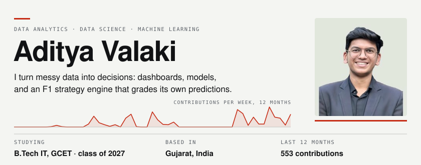
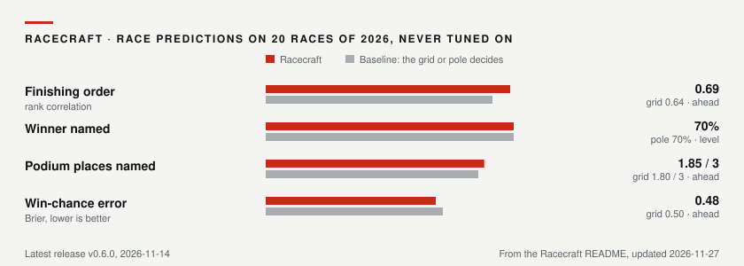
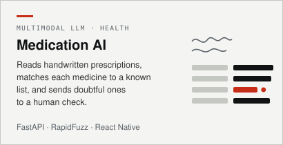
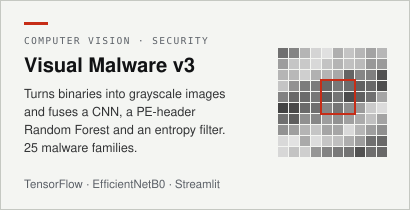
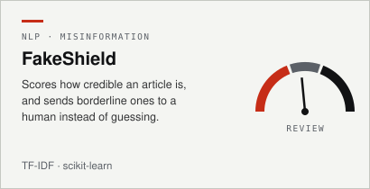
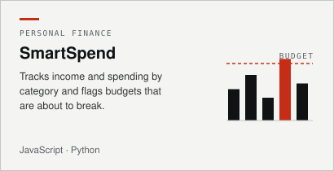
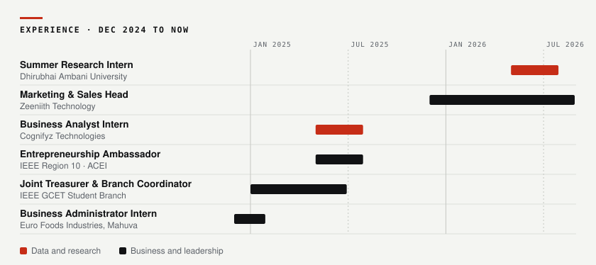

<a href="https://adityavalaki.vercel.app">
<picture>
  <source media="(prefers-color-scheme: dark)" srcset="assets/hero-dark.svg">
  
</picture>
</a>

  <a href="https://adityavalaki.vercel.app"><b>Portfolio</b></a> &nbsp;·&nbsp;
  <a href="https://www.linkedin.com/in/aditya-j-valaki/"><b>LinkedIn</b></a> &nbsp;·&nbsp;
  <a href="mailto:adityavalaki11@gmail.com"><b>Email</b></a> &nbsp;·&nbsp;
  <a href="https://github.com/Adityavalaki/racecraft/releases/latest"><b>Download Racecraft</b></a>

I'm a final-year IT student who likes the unglamorous half of data work: cleaning it, questioning it, and checking whether a model actually beats the obvious answer before trusting it. I've done this in a business-analyst internship, in a healthcare research group at DA-IICT, and, most visibly, in an F1 app that scores every prediction it makes.

&nbsp;

## 01 &nbsp;Featured · Racecraft

A free Windows app that replays every Formula 1 session since 2023 and works out what the timing screens don't show: what each pit stop really cost, how fast each tyre wears, where one driver is quicker than another, and who is likely to win. Race and title odds come from simulating each race thousands of times. The 2026 season was never used for tuning, so it is the honest test.

<picture>
  <source media="(prefers-color-scheme: dark)" srcset="assets/racecraft-dark.svg">
  
</picture>

Python · FastF1 · OpenF1 · DuckDB · Pandas · SciPy · FastAPI · React · TypeScript &nbsp;—&nbsp; [Code](https://github.com/Adityavalaki/racecraft) · [How it's tested](https://github.com/Adityavalaki/racecraft#how-accurate-is-it) · [Download](https://github.com/Adityavalaki/racecraft/releases/latest)

&nbsp;

## 02 &nbsp;More projects

<table>
<tr>
<td width="50%" valign="top">
<a href="mailto:adityavalaki11@gmail.com?subject=Medication%20AI%20walkthrough"><picture><source media="(prefers-color-scheme: dark)" srcset="assets/project-medication-ai-dark.svg"></picture></a>
Private repo · <a href="mailto:adityavalaki11@gmail.com?subject=Medication%20AI%20walkthrough">ask for a walkthrough</a>
</td>
<td width="50%" valign="top">
<a href="https://github.com/Adityavalaki/visual-malware-v3"><picture><source media="(prefers-color-scheme: dark)" srcset="assets/project-visual-malware-dark.svg"></picture></a>
<a href="https://github.com/Adityavalaki/visual-malware-v3">Code</a>
</td>
</tr>
<tr>
<td width="50%" valign="top">
<a href="https://github.com/Adityavalaki/fakeshield"><picture><source media="(prefers-color-scheme: dark)" srcset="assets/project-fakeshield-dark.svg"></picture></a>
<a href="https://github.com/Adityavalaki/fakeshield">Code</a>
</td>
<td width="50%" valign="top">
<a href="https://smartspend.dev"><picture><source media="(prefers-color-scheme: dark)" srcset="assets/project-smartspend-dark.svg"></picture></a>
<a href="https://smartspend.dev">Live app</a> · <a href="https://github.com/Adityavalaki/smartspend">Code</a>
</td>
</tr>
</table>

&nbsp;

## 03 &nbsp;Experience

<picture>
  <source media="(prefers-color-scheme: dark)" srcset="assets/experience-dark.svg">
  
</picture>

<b>What I did in each role</b>

&nbsp;

| When | Role | What I did |
|:--|:--|:--|
| May – Jul 2026 | **Summer Research Intern**, Dhirubhai Ambani University | Worked in the AI and healthcare-technology group on medication adherence. |
| Dec 2025 – Aug 2026 | **Marketing & Sales Head**, Zeeniith Technology | Ran client engagement and communication, and shaped marketing ideas. |
| May – Jul 2025 | **Business Analyst Intern**, Cognifyz Technologies | EDA and correlation analysis on investment data, with dashboards for non-technical stakeholders. |
| May – Jul 2025 | **Entrepreneurship Ambassador**, IEEE Region 10 · ACEI | Brought students from several colleges to IEEE Gujarat Section entrepreneurship events. |
| Jan – Jun 2025 | **Joint Treasurer & Branch Coordinator**, IEEE GCET | Managed event budgets and coordinated the Chemical and Civil branches. |
| Dec 2024 – Jan 2025 | **Business Administrator Intern**, Euro Foods Industries | Client communication for sales and marketing, campaign support and procurement. |

&nbsp;

## 04 &nbsp;Toolkit

**Use most** &nbsp; Python · SQL · Pandas · NumPy · scikit-learn · TensorFlow / Keras · FastAPI · React · Power BI · Excel

**Also used** &nbsp; PyTorch · OpenCV · NLTK · Tableau · IBM Cognos · PostgreSQL · MySQL · MongoDB · DuckDB · Node.js · TypeScript · Flask · Supabase · Firebase · Docker · Git · Linux

**Methods** &nbsp; EDA · feature engineering · statistics and A/B testing · model validation against baselines · dashboard design

&nbsp;

## 05 &nbsp;Currently building

<!-- RECENT:START -->
| Repository | Latest commit | Language | Date |
|:--|:--|:--|:--|
| [**puppy-website-clone**](https://github.com/Adityavalaki/puppy-website-clone) | Finish home page: passport, happy homes, questions and closing CTA | JavaScript | 23&nbsp;Nov&nbsp;2026 |
| [**portfolio**](https://github.com/Adityavalaki/portfolio) | Update CV links in index.html to reflect new file naming convention | HTML | 18&nbsp;Nov&nbsp;2026 |
| [**racecraft**](https://github.com/Adityavalaki/racecraft) | Licence for the public release: free personal use; third-party notice… | Python | 14&nbsp;Nov&nbsp;2026 |
| [**visual-malware-v3**](https://github.com/Adityavalaki/visual-malware-v3) | add sample grayscale malware image | Python | 18&nbsp;Sep&nbsp;2026 |
<!-- RECENT:END -->

<picture>
  <source media="(prefers-color-scheme: dark)" srcset="assets/activity-dark.svg">
  
</picture>

&nbsp;

---

  <b>Looking for someone who checks the model against the baseline?</b> 
  <a href="mailto:adityavalaki11@gmail.com">adityavalaki11@gmail.com</a> &nbsp;·&nbsp; <a href="https://www.linkedin.com/in/aditya-j-valaki/">LinkedIn</a> &nbsp;·&nbsp; <a href="https://adityavalaki.vercel.app">Portfolio</a>
    
  Away from the keyboard: long bike rides, travelling and photography. Cards on this page are drawn from public data by a GitHub Action, every hour.

