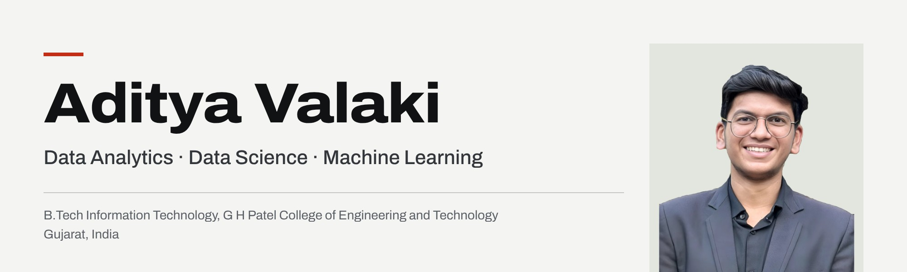
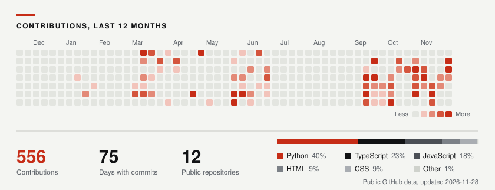

[Portfolio](https://adityavalaki.vercel.app) &nbsp;·&nbsp; [LinkedIn](https://www.linkedin.com/in/aditya-j-valaki/) &nbsp;·&nbsp; [Email](mailto:adityavalaki11@gmail.com)

## About

Final-year B.Tech Information Technology student at G H Patel College of Engineering and Technology, Anand, building a career in data analytics, data science and machine learning.

My work sits where data meets decisions: cleaning and exploring messy datasets, building dashboards, trend models and reports, and training machine learning models for vision and language problems. Recent projects range from an F1 strategy workbench on public timing data to CNN-based malware classification and NLP fake-news detection.

Outside work: long bike rides, travelling to new places, and photography.

## Experience

| Period | Role | Organisation | Highlights |
|:--|:--|:--|:--|
| May – Jul 2026 | **Summer Research Intern** | Dhirubhai Ambani University (formerly DA-IICT) | AI and healthcare-technology group, working on medication adherence. |
| Dec 2025 – Aug 2026 | **Marketing & Sales Head** | Zeeniith Technology | Mainly worked on client engagement, communication with clients, and marketing ideas. |
| May – Jul 2025 | **Entrepreneurship Ambassador** | IEEE Region 10 · ACEI | Rallied students across colleges for IEEE Gujarat Section entrepreneurship events. |
| May – Jul 2025 | **Business Analyst Intern** | Cognifyz Technologies | EDA and correlation analysis on investment data, with dashboards for non-technical stakeholders. |
| Jan – Jun 2025 | **Joint Treasurer & Branch Coordinator** | IEEE GCET Student Branch | Coordinated the Chemical and Civil branches and managed event budgets as Joint Treasurer. |
| Dec 2024 – Jan 2025 | **Business Administrator Intern** | Euro Foods Industries, Mahuva | Client communication for sales and marketing, campaign support and procurement. |

## Education

**B.Tech, Information Technology**, G H Patel College of Engineering & Technology, CVM University, Anand 
Jun 2023 – Jun 2027 (expected)

## Projects

**[Racecraft](https://github.com/Adityavalaki/racecraft)** &nbsp;·&nbsp; [Download for Windows](https://github.com/Adityavalaki/racecraft/releases/latest) 
A free Windows app that replays every F1 session since 2023 on a live track map and works out what the timing screens don't show: what each pit stop really cost, how fast each tyre wears, where one driver is quicker than another, and who is likely to win. Race and title odds come from simulating each race thousands of times, and every prediction is scored against what then happened. The 2026 season was never used for tuning, so it is the honest test, and the card below re-reads those scores from the Racecraft repo automatically.
 Python · FastF1 · OpenF1 · DuckDB · Pandas · SciPy · FastAPI · React · TypeScript

<picture>
  <source media="(prefers-color-scheme: dark)" srcset="assets/racecraft-dark.svg">
  
</picture>

| Project | Description | Stack | Code |
|:--|:--|:--|:--|
| **Medication AI App** | Reads handwritten prescriptions with a benchmarked multimodal LLM behind a FastAPI back end, snaps medicine names to a known list with RapidFuzz and routes low-confidence items to a verification step, with dose reminders and one-tap SOS in React Native. | Python, FastAPI, React Native (Expo), RapidFuzz, LLM APIs | Private · [walkthrough on request](mailto:adityavalaki11@gmail.com?subject=Medication%20AI%20walkthrough) |
| **Visual Malware v3** | Three-layer detector: an entropy pre-filter, an EfficientNetB0 CNN on grayscale byte-plot images (Malimg, 25 families) and a Random Forest on 69 PE-header features, fused by weighted scoring and served as a Streamlit app. | Python, TensorFlow / Keras, EfficientNetB0, scikit-learn, Streamlit | [Code](https://github.com/Adityavalaki/visual-malware-v3) |
| **SmartSpend** | Personal finance tracker with income and expense recording, category-wise aggregation and budget-limit checks, with a data model ready for predictive expense analytics. | JavaScript, Python, HTML / CSS | [Live app](https://smartspend.dev) · [Code](https://github.com/Adityavalaki/smartspend) |
| **FakeShield** | NLP misinformation detector: text cleaning, tokenisation and TF-IDF features feed supervised classifiers, and the output is a credibility score so borderline content goes to human review. | Python, NLP, TF-IDF, scikit-learn | [Code](https://github.com/Adityavalaki/fakeshield) |

## Skills

| Area | Skills |
|:--|:--|
| **Languages** | Python · JavaScript · SQL · Java · C/C++ · HTML5 · CSS3 · Bash |
| **Data Science & ML** | Pandas · NumPy · Scikit-Learn · TensorFlow · Keras · PyTorch · OpenCV · NLTK · Matplotlib · Seaborn · EDA · Feature Engineering |
| **Analytics & BI** | Power BI · Tableau · IBM Cognos · Excel · Google Sheets · MySQL · PostgreSQL · MongoDB · Statistics · A/B Testing |
| **Web & App Development** | React · Node.js · Express · Tailwind CSS · Bootstrap · Flask · REST APIs · Supabase · Firebase |
| **Tools & Platforms** | Git · GitHub · VS Code · Jupyter · Google Colab · Linux · Docker · Postman · Figma |
| **Professional** | Prompt Engineering · Problem Solving · Public Speaking · Leadership · Marketing · Sales · Agile · Research |

## Currently building

<!-- RECENT:START -->
| Repository | Latest commit | Language | Date |
|:--|:--|:--|:--|
| [**portfolio**](https://github.com/Adityavalaki/portfolio) | Replace CV with updated version reflecting new skills and projects, i… | HTML | 2026-11-18 |
| [**racecraft**](https://github.com/Adityavalaki/racecraft) | Licence for the public release: free personal use; third-party notice… | Python | 2026-11-14 |
| [**visual-malware-v3**](https://github.com/Adityavalaki/visual-malware-v3) | add sample grayscale malware image | Python | 2026-09-18 |
| [**VALAKIEXPORTS**](https://github.com/Adityavalaki/VALAKIEXPORTS) | new | JavaScript | 2026-06-26 |
<!-- RECENT:END -->

## GitHub activity

<picture>
  <source media="(prefers-color-scheme: dark)" srcset="assets/activity-dark.svg">
  
</picture>

## Contact

**[adityavalaki11@gmail.com](mailto:adityavalaki11@gmail.com)**
 [Portfolio](https://adityavalaki.vercel.app) &nbsp;·&nbsp; [LinkedIn](https://www.linkedin.com/in/aditya-j-valaki/) &nbsp;·&nbsp; [GitHub](https://github.com/Adityavalaki)
